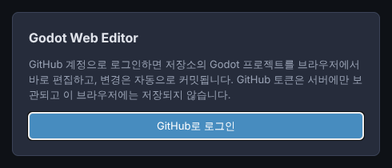
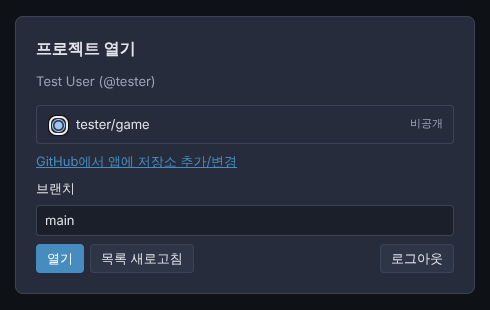
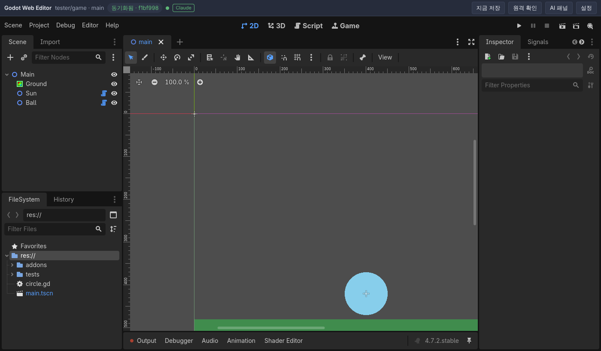
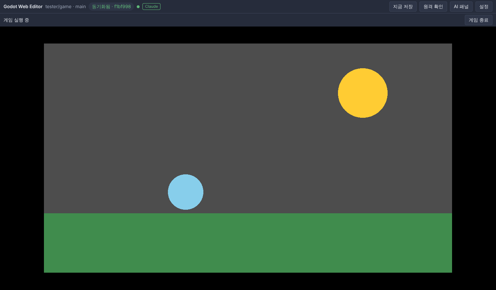
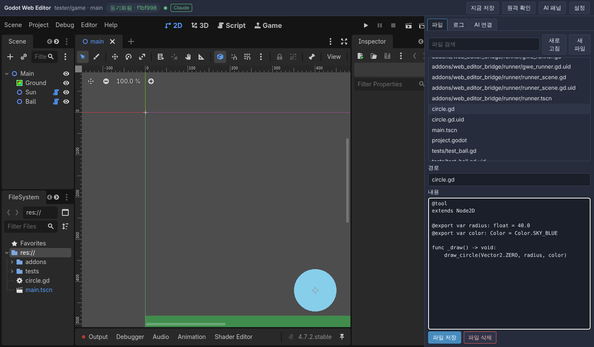
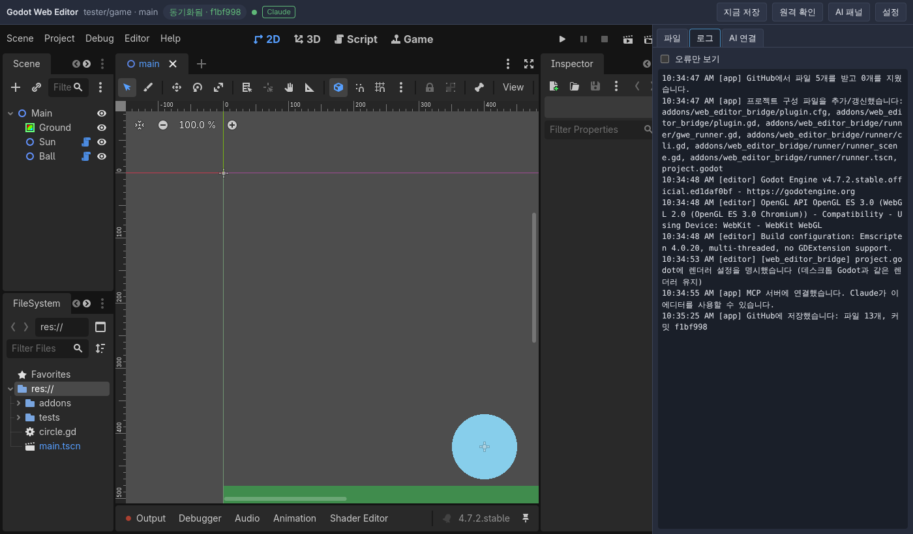
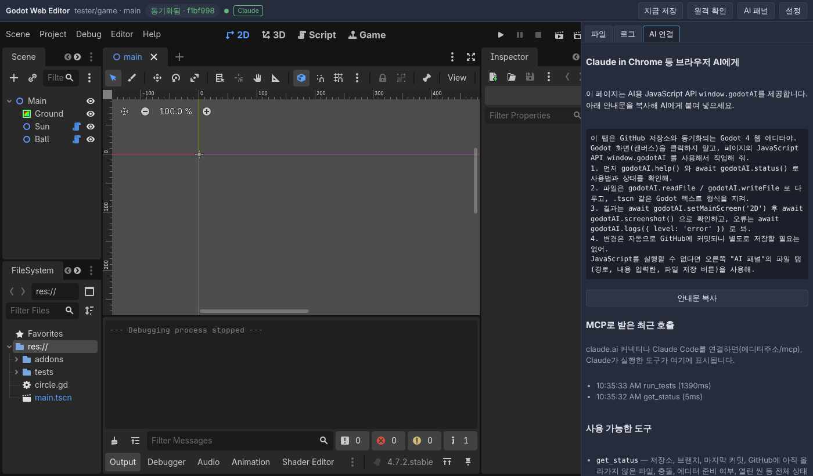
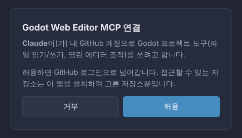
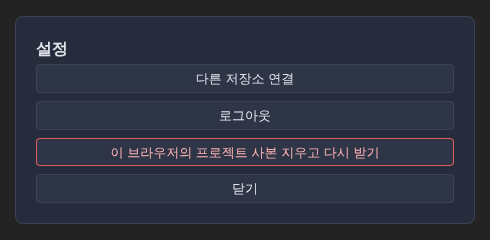

# 사용자 매뉴얼

Godot Web Editor는 설치 없이 **브라우저에서 Godot 4 게임을 만드는** 에디터입니다.
프로젝트는 내 **GitHub 저장소에 자동으로 저장**되고, **Claude**에게 작업을 맡길 수도 있습니다.

- 주소: **https://godotweb.solitary-cloud-8e56.workers.dev**
- 필요한 것: GitHub 계정, 데스크톱 **Chrome 또는 Edge**

> 서비스를 직접 운영(배포, GitHub App 설정)하려면 [CLOUD-SETUP.md](CLOUD-SETUP.md)를 보세요. 이 문서는 사용하는 사람을 위한 안내입니다.

## 목차
1. [처음 시작하기](#1-처음-시작하기)
2. [화면 둘러보기](#2-화면-둘러보기)
3. [저장과 동기화](#3-저장과-동기화)
4. [게임 실행](#4-게임-실행)
5. [AI 패널](#5-ai-패널)
6. [Claude와 함께 만들기](#6-claude와-함께-만들기)
7. [테스트 작성과 실행](#7-테스트-작성과-실행)
8. [설정](#8-설정)
9. [문제 해결](#9-문제-해결)
10. [알아둘 점](#10-알아둘-점)

---

## 1. 처음 시작하기

### 1-1. 게임용 저장소 준비
GitHub에서 게임을 담을 저장소를 하나 만듭니다. 비공개여도 됩니다.
- **빈 저장소**여도 됩니다. 처음 열 때 기본 `project.godot`과 `.gitignore`를 만들어 줍니다.
- 이미 있는 Godot 4 프로젝트 저장소도 그대로 열 수 있습니다.

### 1-2. 로그인
에디터 주소를 열고 **GitHub로 로그인**을 누릅니다.



처음이라면 GitHub에서 **앱 설치** 화면이 나옵니다.
- **Only select repositories**를 고르고 게임 저장소를 선택한 뒤 **Install**을 누르세요.
- 여기서 고른 저장소에만 접근할 수 있습니다. 나중에 언제든 바꿀 수 있습니다.

GitHub 토큰은 서버에만 보관되고 이 브라우저에는 저장되지 않습니다.

### 1-3. 프로젝트 열기
목록에서 저장소를 고르고 **열기**를 누릅니다. 브랜치는 보통 그대로(`main`) 둡니다.



- 목록에 저장소가 없으면 **GitHub에서 앱에 저장소 추가/변경**을 누르고 저장소를 추가한 뒤 **목록 새로고침**을 누르세요.
- 한 번 연 프로젝트는 다음부터 **바로 열립니다**.

### 1-4. 첫 로딩
처음에는 Godot 엔진(약 100MB)을 받느라 시간이 걸립니다. 다음부터는 브라우저에 저장된 사본을 써서 금방 열립니다.

처음 열면 저장소에 아래 항목이 자동으로 추가·커밋됩니다.
- `addons/web_editor_bridge/`: 웹 페이지와 에디터를 잇는 작은 플러그인입니다. 테스트 실행기도 들어 있습니다.
  **데스크톱 Godot이나 다른 곳에서 열면 아무 동작도 하지 않으니** 지우지 마세요.
- `project.godot`의 플러그인 활성화 항목. 기존 설정(이름, 메인 씬, 렌더러 등)은 그대로 둡니다.

---

## 2. 화면 둘러보기



아래쪽은 일반 Godot 에디터와 같습니다. 맨 위 표시줄만 이 서비스의 것입니다.

| 표시 | 뜻 |
|---|---|
| `tester/game · main` | 지금 연 저장소와 브랜치 |
| `동기화됨 · f1bf998` | 상태. 동기화됨(마지막 커밋 번호) / 저장 대기 N개 / 받는 중… / 오류 |
| 초록 점 ● | 에디터 플러그인(브리지) 연결됨. 회색이면 실시간 반영과 AI 도구가 제한됩니다 |
| `Claude` 배지 | Claude 연결 상태. 초록이면 Claude가 이 에디터를 조종할 수 있습니다. 마우스를 올리면 자세한 상태가 보입니다 |
| **지금 저장** | 열린 씬을 저장하고 바로 GitHub에 커밋합니다 |
| **원격 확인** | GitHub의 새 커밋을 바로 받습니다 |
| **AI 패널** | 파일, 로그, AI 연결 탭을 엽니다 ([5장](#5-ai-패널)) |
| **설정** | 저장소 변경, 로그아웃 등 ([8장](#8-설정)) |

---

## 3. 저장과 동기화

### 내 작업 올리기
평소처럼 작업하고 `Ctrl+S`로 저장하면 됩니다.
- 저장된 변경은 **약 30초마다 자동으로 GitHub에 커밋**됩니다. 커밋 작성자는 **내 GitHub 계정**입니다.
- 바로 올리고 싶으면 **지금 저장**을 누르세요.
- `.godot/` 같은 캐시 폴더는 커밋하지 않습니다 (`.gitignore`를 따름).

### 다른 곳의 변경 받기
Claude Code, 다른 PC, GitHub 웹 등에서 저장소에 커밋하면 **약 30초 안에 열린 에디터에 반영**됩니다.
- 탭으로 돌아오거나 **원격 확인**을 누르면 바로 받습니다.
- 열려 있는 씬이 바뀌면 에디터가 다시 불러옵니다.

### 충돌
같은 파일을 브라우저와 원격에서 동시에 바꾸면 **브라우저 쪽 내용을 남깁니다**.
- 원격 버전은 GitHub 커밋 기록에 그대로 있습니다.
- 어떤 커밋이었는지는 **AI 패널 → 로그**에 표시됩니다.

### 파일을 많이 지우는 저장은 멈춥니다
한 번에 많은 파일(또는 `project.godot`)을 지우는 저장은 **자동 저장이 멈추고** 확인을 기다립니다.
브라우저 저장 공간이 날아가서 생기는 사고를 막기 위한 장치입니다.
- 정말 지운 게 맞다면 **지금 저장**을 누르고 확인 창에서 **확인**을 누르세요.
- 지운 적이 없다면 **취소**하고 **설정 → 이 브라우저의 프로젝트 사본 지우고 다시 받기**를 누르세요. GitHub의 파일은 그대로입니다.

---

## 4. 게임 실행

에디터 오른쪽 위의 ▶ 버튼으로 실행합니다. 게임은 에디터 위에 겹쳐 뜹니다.



- 끝내려면 위쪽의 **게임 종료**를 누릅니다.
- `print()` 출력과 오류는 에디터 하단 **Output**과 **AI 패널 → 로그**에서 볼 수 있습니다.

---

## 5. AI 패널

상단의 **AI 패널**을 누르면 오른쪽에 열립니다.

### 파일 탭
프로젝트 파일을 직접 보고 고칠 수 있습니다.
- 목록에서 파일을 누르면 내용이 열립니다. 수정 후 **파일 저장**을 누르세요.
- **새 파일**: 경로(예: `scripts/player.gd`)와 내용을 넣고 저장합니다.
- 저장한 내용은 에디터에 바로 반영되고 자동으로 커밋됩니다.



### 로그 탭
에디터와 동기화 기록, Godot 출력이 보입니다. **오류만 보기**로 오류만 걸러 볼 수 있습니다.



### AI 연결 탭
- **Claude in Chrome 등 브라우저 AI**에게 줄 안내문이 있습니다. **안내문 복사** 후 AI에게 붙여 넣으세요.
- **MCP로 받은 최근 호출**: Claude가 이 에디터에서 실행한 도구가 시간순으로 보입니다.
- **사용 가능한 도구**: Claude가 쓸 수 있는 도구 목록입니다.



---

## 6. Claude와 함께 만들기

Claude에 이 에디터를 **커넥터(MCP)** 로 한 번 연결해 두면, 대화로 게임을 만들 수 있습니다.

### 6-1. 연결하기 (한 번만)

**claude.ai (웹, 데스크톱 앱, 휴대폰 앱)**
1. claude.ai → **설정 → 커넥터 → 커스텀 커넥터 추가**
2. 주소에 `https://godotweb.solitary-cloud-8e56.workers.dev/mcp`를 넣습니다.
3. **연결**을 누르면 아래 승인 화면이 나옵니다. **허용**을 누르면 GitHub 로그인으로 넘어갑니다. 이미 로그인했다면 바로 끝납니다.



**Claude Code**

터미널에서 아래 명령을 실행합니다.
```bash
claude mcp add --transport http godot https://godotweb.solitary-cloud-8e56.workers.dev/mcp
```
그다음 Claude Code에서 `/mcp` → `godot` → 인증을 고르면 브라우저에서 같은 승인 화면이 열립니다.

연결은 30일 동안 쓰지 않으면 만료됩니다. 쓰는 동안은 자동으로 연장됩니다.

### 6-2. 에디터를 열어 두면 vs 닫아 두면

| | 에디터가 열려 있음 (`Claude` 배지 초록) | 에디터가 닫혀 있음 (휴대폰 등) |
|---|---|---|
| 파일 읽기/쓰기 | 에디터에 바로 보이고, 자동 저장이 커밋 | GitHub에 바로 커밋 |
| 씬 열기, 스크린샷, 게임 실행, 로그 | 가능 | 불가 ("에디터를 여세요" 안내) |
| 테스트 실행, 스크립트 검사 | 브라우저 안에서 몇 초 | GitHub Actions에서 1~2분 |

어느 경우든 커밋 작성자는 **나**입니다.

### 6-3. 이렇게 부탁해 보세요
- "my-game 프로젝트에 플레이어가 방향키로 움직이는 씬 만들어 줘. 만들고 스크린샷 보여 줘."
- "지금 열린 씬에서 적을 3마리 배치하고 실행해서 오류 없는지 확인해 줘."
- "스크립트 오류 검사해 주고, 있으면 고쳐 줘."
- "점수 계산 함수에 대한 테스트를 tests/에 만들고 돌려 줘."

여러 저장소를 쓴다면 프로젝트 이름을 같이 말해 주세요.
대상을 말하지 않으면 **열려 있는 에디터의 프로젝트**에서, 없으면 **마지막으로 연 프로젝트**에서 작업합니다.

### 다른 AI 도구
- **Claude in Chrome 등 브라우저 AI**: AI 패널 → AI 연결의 안내문을 복사해 주세요. 페이지의 `window.godotAI` API로 작업합니다.
- **Claude Code만 쓰고 커넥터 없이**: 저장소를 클론해서 커밋·푸시하면 열린 에디터에 자동 반영됩니다.

---

## 7. 테스트 작성과 실행

게임 로직을 테스트로 확인할 수 있습니다. Claude에게 "테스트 돌려 줘"라고 하면 실행합니다(`run_tests`).

### 규칙
- 파일 위치: `tests/test_이름.gd`
- 함수 이름: `test_`로 시작. 인자로 검사 도우미 `t`를 받습니다.
  - `t.ok(조건, "설명")`: 조건이 참이어야 함
  - `t.eq(실제값, 기대값, "설명")`: 두 값이 같아야 함

```gdscript
# tests/test_score.gd
extends RefCounted

const Score := preload("res://scripts/score.gd")

func test_combo_bonus(t):
	t.eq(Score.calc(3, true), 60, "콤보면 2배")

func test_no_negative(t):
	t.ok(Score.calc(-1, false) >= 0, "점수는 음수가 되지 않음")
```

- 노드 기능(트리 안에서만 되는 것)이 필요하면 `extends Node`로 쓰면 됩니다.
- 특정 파일만 돌리려면 "test_score만 돌려 줘"처럼 말하세요.

### 스크립트 오류 검사
"스크립트 오류 검사해 줘"라고 하면(`check_scripts`) 모든 `.gd` 파일의 문법 오류를 파일·줄 번호와 함께 알려 줍니다.

---

## 8. 설정

상단의 **설정**을 누릅니다.



| 버튼 | 하는 일 |
|---|---|
| **다른 저장소 연결** | 프로젝트 선택 화면으로 돌아갑니다 |
| **로그아웃** | 이 브라우저에서 로그아웃합니다. 아직 안 올라간 파일은 브라우저에 남아 있다가 다시 로그인하면 올라갑니다 |
| **이 브라우저의 프로젝트 사본 지우고 다시 받기** | 브라우저에 저장된 사본을 버리고 GitHub에서 새로 받습니다. 아직 안 올라간 변경은 사라지니 주의하세요 |

---

## 9. 문제 해결

| 증상 | 해결 |
|---|---|
| 로딩이 "내려받는 중"에서 멈춤 | `Ctrl+Shift+R`(강력 새로고침)을 누릅니다. 그래도 안 되면 탭을 닫았다가 다시 엽니다 |
| 프로젝트 목록에 저장소가 없음 | 선택 화면의 **GitHub에서 앱에 저장소 추가/변경**에서 저장소를 추가 → **목록 새로고침** |
| 상태가 `오류`로 바뀜 | **AI 패널 → 로그**에서 원인을 확인합니다. "로그인이 만료" 같은 내용이면 다시 로그인하세요. 변경은 브라우저에 남아 있습니다 |
| "파일 N개를 GitHub에서 삭제합니다" 확인 창 | [3장의 설명](#파일을-많이-지우는-저장은-멈춥니다)대로, 지운 적이 없으면 **취소** 후 사본 다시 받기 |
| 초록 점이 회색, "브리지가 연결되지 않았습니다" | Godot 메뉴 **Project → Project Settings → Plugins**에서 **Web Editor Bridge**를 켭니다 |
| 다른 곳의 커밋이 안 보임 | **원격 확인**을 누릅니다 |
| Claude가 "웹 에디터가 열려 있어야" 함 | 스크린샷·실행 같은 도구는 에디터가 필요합니다. 에디터를 열고 `Claude` 배지가 초록인지 확인하세요 |
| `Claude` 배지가 빨강(연결 실패) | 페이지를 새로고침하고, 계속되면 로그아웃 후 다시 로그인합니다 |
| Claude 연결이 갑자기 안 됨 | claude.ai 커넥터 설정에서 연결 해제 후 다시 연결합니다 |
| 에디터를 두 탭 이상 열었음 | 같은 프로젝트는 한 탭에서만 여는 것을 권장합니다. 여러 개면 Claude는 화면에 보이는 탭, 그중 가장 최근에 연 탭을 조종합니다 |

---

## 10. 알아둘 점

- Godot 웹 에디터의 한계
  - **Compatibility 렌더러만** 쓸 수 있습니다.
  - **GDScript만** 쓸 수 있습니다 (C# 불가).
  - 휴대폰이나 태블릿에서는 에디터가 동작하지 않습니다. 이때는 Claude 커넥터로 작업하고, 결과는 PC에서 확인하세요.
- 브라우저 저장 공간에 프로젝트 사본이 있습니다.
  - 브라우저 데이터를 지우면 사본도 지워집니다.
  - 이미 커밋된 내용은 GitHub에 있으니 다시 받으면 됩니다.
- 데스크톱 Godot에서도 같은 저장소를 열 수 있습니다. 커밋·푸시하면 웹 에디터에 반영됩니다.
